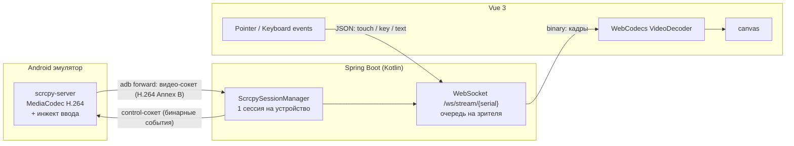

# Android Emulator Web

Веб-приложение, которое показывает экран Android-эмулятора (или реального устройства) в браузере в реальном
времени и передаёт обратно касания, жесты, прокрутку и клавиатуру.

- **Backend:** Kotlin + Spring Boot (Maven), WebSocket, Java 21 virtual threads
- **Frontend:** Vue 3 + TypeScript + Vite, WebCodecs `VideoDecoder`
- **На устройстве:** [scrcpy-server](https://github.com/Genymobile/scrcpy) 3.1 (аппаратный H.264-энкодер + инжект событий)



## Откуда низкая задержка

| Звено | Что сделано |
|---|---|
| Захват и кодирование | `scrcpy-server` захватывает дисплей через `SurfaceControl`/`VirtualDisplay` и кодирует его аппаратным `MediaCodec` в H.264 прямо на устройстве. Никаких скриншотов и PNG. |
| Транспорт device → backend | `adb forward` + TCP с `TCP_NODELAY`, пакеты читаются без буферизации кадров. |
| Backend | Пакеты не перекодируются, а проксируются как есть (9-байтный заголовок + Annex B). Для каждого зрителя своя очередь и свой поток отправки: медленный браузер не тормозит остальных. Если очередь переполнилась — буфер сбрасывается, зритель ждёт следующий key frame, а устройство просит перезапустить энкодер (`RESET_VIDEO`). Задержка важнее полноты. |
| Браузер | WebCodecs `VideoDecoder` с `optimizeForLatency: true` (аппаратное декодирование, без буфера переупорядочивания). Кадр рисуется на `<canvas>` сразу в колбэке декодера (`desynchronized: true`), без очереди и `<video>`-буфера. Если декодер не успевает — бэклог сбрасывается. |
| Ввод | Pointer Events (включая coalesced events и мультитач) → JSON по тому же WebSocket → бинарные control-сообщения scrcpy → `InputManager.injectInputEvent` на устройстве. |

На локальной машине итоговая задержка «палец → картинка» обычно 30–60 мс (в основном это энкодер устройства и vsync).

## Быстрый старт (разработка)

Требования: JDK 21, Maven 3.9+, Node.js 20+, Android SDK `platform-tools` (`adb` в `PATH`) и запущенный эмулятор
(`emulator -avd <name>` или Android Studio). Проверьте, что `adb devices` его видит.

```bash
./scripts/download-scrcpy-server.sh
```

```bash
cd backend && mvn spring-boot:run
```

```bash
cd frontend && npm install && npm run dev
```

Откройте http://localhost:5173 и выберите устройство слева. Vite проксирует `/api` и `/ws` на `localhost:8080`.

## Сборка в один jar

```bash
cd backend && mvn -Pwith-frontend package
```

```bash
java -jar backend/target/android-emul-backend-0.1.0-SNAPSHOT.jar --emulator.scrcpy.server-path=scrcpy-server/scrcpy-server
```

UI и API будут на http://localhost:8080.

> WebCodecs работает только в *secure context*: `localhost` или HTTPS. Для доступа с другой машины поставьте приложение
> за reverse proxy с TLS (nginx, Caddy) — WebSocket проксируется на `/ws/`.

## Docker

**Эмулятор на хосте** (backend в контейнере использует adb-сервер хоста):

```bash
adb kill-server && adb -a nodaemon server start
```

```bash
docker compose up --build
```

**Всё в контейнерах** (нужен Linux с KVM):

```bash
docker compose -f docker-compose.emulator.yml up --build
```

## Использование

- мышь / тач / стилус — касания, свайпы, мультитач (pinch-to-zoom на тач-экране);
- колесо мыши — прокрутка;
- правая кнопка мыши — «Назад», средняя — «Домой»;
- клавиатура (при фокусе на экране): печать текста, Enter/Backspace/стрелки, сочетания с Ctrl; Ctrl+V вставляет текст;
- кнопки: Назад / Домой / Недавние, питание, громкость, поворот, шторка уведомлений, скриншот;
- несколько вкладок/пользователей могут смотреть одно устройство одновременно (сессия на устройстве одна).

## Конфигурация

`backend/src/main/resources/application.yml`, всё переопределяется переменными окружения:

| Переменная | По умолчанию | Описание |
|---|---|---|
| `PORT` | `8080` | HTTP-порт |
| `ADB_PATH` | `adb` | путь к adb |
| `ADB_FORWARD_HOST` | `127.0.0.1` | где открываются порты `adb forward` (для adb-сервера хоста из Docker — `host.docker.internal`) |
| `ADB_AUTO_CONNECT` | — | адреса для автоматического `adb connect`, через запятую |
| `SCRCPY_SERVER_PATH` | `../scrcpy-server/scrcpy-server` | локальный файл scrcpy-server |
| `SCRCPY_VERSION` | `3.1` | версия scrcpy-server (должна точно совпадать с файлом) |
| `STREAM_MAX_SIZE` | `1280` | максимальная сторона видео, `0` — нативное разрешение |
| `STREAM_BIT_RATE` | `8000000` | битрейт H.264 |
| `STREAM_MAX_FPS` | `60` | ограничение FPS |
| `STREAM_CODEC_OPTIONS` | — | опции MediaCodec, например `i-frame-interval=2` |
| `STREAM_ENCODER` | — | конкретный энкодер, например `OMX.google.h264.encoder` |
| `ALLOWED_ORIGINS` | `*` | разрешённые Origin для WebSocket |

## Протокол

**REST**

- `GET /api/devices` — список устройств из `adb devices -l`;
- `POST /api/devices/connect?address=host:port` — `adb connect`;
- `GET /api/config` — параметры видеопотока.

**WebSocket `/ws/stream/{serial}`**

Сервер → клиент:

- binary: `[flags:1][pts:8 BE][H.264 Annex B]`, `flags`: `1` — config (SPS/PPS), `2` — key frame;
- JSON: `{"type":"starting"}`, `{"type":"started","deviceName","width","height"}`, `{"type":"closed","reason"}`, `{"type":"pong","t"}`.

Клиент → сервер (JSON):

```json
{"type":"touch","action":0,"pointerId":0,"x":360,"y":640,"width":720,"height":1280,"pressure":1}
{"type":"scroll","x":360,"y":640,"width":720,"height":1280,"hScroll":0,"vScroll":-1}
{"type":"key","action":0,"keycode":4,"metaState":0}
{"type":"text","text":"hello"}
{"type":"command","name":"rotate"}
{"type":"ping","t":123.4}
```

`action`: `0` down, `1` up, `2` move. Координаты передаются в пикселях текущего декодированного кадра вместе с его размером —
так scrcpy отбрасывает «устаревшие» события после поворота экрана. Команды: `expandNotifications`, `expandSettings`,
`collapsePanels`, `rotate`, `resetVideo`, `screenOn`, `screenOff`.

## Структура

```
backend/   Spring Boot (Kotlin)
  adb/       обёртка над adb CLI
  scrcpy/    протокол scrcpy, сессия устройства, менеджер сессий
  ws/        WebSocket-обработчик, очередь зрителя, DTO событий
  api/       REST
frontend/  Vue 3
  lib/decoder.ts   WebCodecs H.264 декодер
  lib/stream.ts    WebSocket-клиент
  lib/keymap.ts    клавиатура → Android keycodes
  components/      список устройств, экран с вводом
scripts/   загрузка scrcpy-server
```

## Ограничения

- Звук не транслируется (`audio=false`), его можно добавить через аудиопоток scrcpy (Opus) и WebCodecs `AudioDecoder`.
- Ввод не-ASCII текста через `INJECT_TEXT` зависит от раскладки устройства (то же ограничение, что и у scrcpy).
- Аутентификации нет: не выставляйте сервис в открытую сеть без reverse proxy с авторизацией.
