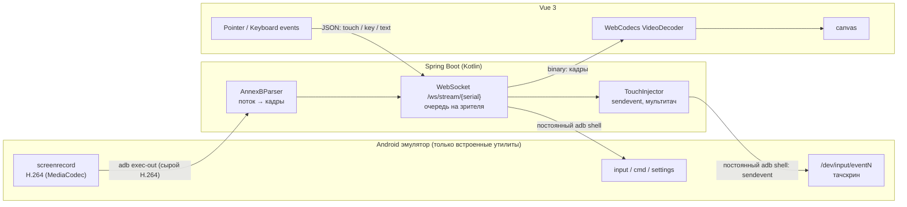

# Android Emulator Web

Веб-приложение, которое показывает экран Android-эмулятора (или реального устройства) в браузере в реальном
времени и передаёт обратно касания, жесты, прокрутку и клавиатуру.

- **Backend:** Kotlin + Spring Boot (Maven), WebSocket, Java 21 virtual threads
- **Frontend:** Vue 3 + TypeScript + Vite, WebCodecs `VideoDecoder`
- **На устройстве:** ничего не устанавливается — только стандартные утилиты Android через `adb`

## Как это работает

Используются только стандартные утилиты Android, вызываемые через `adb`. На эмулятор ничего не устанавливается,
сторонних программ и сервисов нет.



## Подробности

- **Видео.** `adb exec-out screenrecord --output-format=h264 --size WxH --bit-rate N -` отдаёт сырой поток H.264.
  У него нет заголовков пакетов, поэтому backend сам режет его на SPS/PPS и кадры (`AnnexBParser`). Кадр отправляется,
  как только поток «затих» на 2 мс (screenrecord пишет кадр целиком за раз), — последний кадр анимации не залипает.
- **Key frame по запросу.** Новому зрителю и зрителю, потерявшему синхронизацию, нужен ключевой кадр. Единственный способ
  получить его от `screenrecord` — перезапустить запись (не чаще раза в секунду, запросы объединяются).
- **3-минутный лимит.** На Android 14+ используется `--time-limit 0` (без ограничения). На старых версиях это значение
  отвергается — backend сам переключается на сегменты по 180 с и перезапускает запись по их окончании.
- **Поворот экрана.** Ориентация опрашивается раз в секунду (`dumpsys input`); при смене запись перезапускается
  с новым размером, а координаты касаний пересчитываются под ориентацию панели.
- **Касания.** При старте `getevent -lp` находит тачскрин и диапазоны его осей. События пишутся как настоящий драйвер
  (multi-touch protocol B: `ABS_MT_SLOT`, `ABS_MT_TRACKING_ID`, `ABS_MT_POSITION_X/Y`, `BTN_TOUCH`, `SYN_REPORT`)
  командами `sendevent` в **одну постоянную** `adb shell`-сессию — без запуска процесса adb и JVM на каждое событие.
  Пока устройство выполняет пачку событий, новые движения пальца копятся и схлопываются в последнее положение,
  поэтому ввод не отстаёт. Если тачскрин недоступен, жест воспроизводится через `input tap` / `input swipe` после отпускания.
- **Выбор способа ввода.** При старте сессии backend выбирает тачскрин по `getevent -lp` и `dumpsys input`
  (эмулятор создаёт до 11 виртуальных тачскринов — по одному на возможный дисплей; берётся включённый и привязанный
  к дисплею 0) и проверяет `sendevent` на практике. Если запись в `/dev/input` запрещена, касания идут через
  `input motionevent` (живой drag одним пальцем, Android 10+), в крайнем случае — `input tap/swipe`. Если `sendevent`
  начинает возвращать ошибки во время работы, переключение происходит на лету. Выбранный способ виден в логе
  (`Touch input: ...`) и в оверлее статистики (`ввод: sendevent`).
- **Клавиши, текст, системные команды** — отдельная постоянная shell-сессия: `input keyevent` (подряд идущие клавиши
  объединяются в один вызов), `input text`, `cmd statusbar expand-notifications`, `settings put system user_rotation`.

## Быстрый старт (разработка)

Требования: JDK 21, Maven 3.9+, Node.js 20+, Android SDK `platform-tools` и запущенный эмулятор
(`emulator -avd <name>` или Android Studio). Проверьте, что `adb devices` его видит.

`adb` ищется по порядку: `ADB_PATH` → `PATH` → `$ANDROID_HOME/platform-tools` → `$ANDROID_SDK_ROOT/platform-tools` →
`~/Android/Sdk/platform-tools` (Linux) → `~/Library/Android/sdk/platform-tools` (macOS) → `%LOCALAPPDATA%\Android\Sdk\platform-tools` (Windows).
Если SDK стоит в другом месте — задайте `ADB_PATH=/path/to/adb` или `ANDROID_HOME`.

```bash
cd backend && mvn spring-boot:run
```

```bash
cd frontend && npm install && npm run dev
```

Откройте http://localhost:5173 и выберите устройство слева. Vite проксирует `/api` и `/ws` на `localhost:8080`.

## Сборка в один jar

```bash
cd backend && mvn -Pwith-frontend package
```

```bash
java -jar backend/target/android-emul-backend-0.1.0-SNAPSHOT.jar
```

UI и API будут на http://localhost:8080.

> WebCodecs работает только в *secure context*: `localhost` или HTTPS. Для доступа с другой машины поставьте приложение
> за reverse proxy с TLS (nginx, Caddy) — WebSocket проксируется на `/ws/`.

## Docker

**Эмулятор на хосте** (backend в контейнере использует adb-сервер хоста):

```bash
adb kill-server && adb -a nodaemon server start
```

```bash
docker compose up --build
```

**Всё в контейнерах** (нужен Linux с KVM):

```bash
docker compose -f docker-compose.emulator.yml up --build
```

Образ содержит только JRE и `adb`.

## Использование

- мышь / тач / стилус — касания, свайпы, мультитач (pinch-to-zoom на тач-экране);
- колесо мыши — прокрутка;
- правая кнопка мыши — «Назад», средняя — «Домой»;
- клавиатура (при фокусе на экране): печать текста, Enter/Backspace/стрелки, сочетания с Ctrl; Ctrl+V вставляет текст;
- кнопки: Назад / Домой / Недавние, питание, громкость, поворот, шторка уведомлений, скриншот;
- несколько вкладок/пользователей могут смотреть одно устройство одновременно (сессия на устройстве одна).

## Конфигурация

`backend/src/main/resources/application.yml`, всё переопределяется переменными окружения:

| Переменная | По умолчанию | Описание |
|---|---|---|
| `PORT` | `8080` | HTTP-порт |
| `ADB_PATH` | автопоиск | путь к adb (если не задан — `PATH`, `ANDROID_HOME`, стандартные папки SDK) |
| `ADB_AUTO_CONNECT` | — | адреса для автоматического `adb connect`, через запятую |
| `STREAM_MAX_SIZE` | `1280` | максимальная сторона видео, `0` — нативное разрешение |
| `STREAM_BIT_RATE` | `8000000` | битрейт H.264 |
| `ALLOWED_ORIGINS` | `*` | разрешённые Origin для WebSocket |

Тонкие настройки (`emulator.native.*`): `rotation-poll-interval`, `key-frame-cooldown`, `frame-flush-delay`.

## Протокол

**REST**

- `GET /api/devices` — список устройств из `adb devices -l`;
- `POST /api/devices/connect?address=host:port` — `adb connect`;
- `GET /api/config` — параметры видеопотока;
- `GET /api/devices/{serial}/diagnostics` — диагностика ввода (тачскрины, `dumpsys input`, пробный `sendevent`).

**WebSocket `/ws/stream/{serial}`**

Сервер → клиент:

- binary: `[flags:1][pts:8 BE][H.264 Annex B]`, `flags`: `1` — config (SPS/PPS), `2` — key frame;
- JSON: `{"type":"starting"}`, `{"type":"started","deviceName","width","height"}`, `{"type":"closed","reason"}`, `{"type":"pong","t"}`.

Клиент → сервер (JSON):

```json
{"type":"touch","action":0,"pointerId":0,"x":360,"y":640,"width":720,"height":1280,"pressure":1}
{"type":"scroll","x":360,"y":640,"width":720,"height":1280,"hScroll":0,"vScroll":-1}
{"type":"key","action":0,"keycode":4,"metaState":0}
{"type":"text","text":"hello"}
{"type":"command","name":"rotate"}
{"type":"ping","t":123.4}
```

`action`: `0` down, `1` up, `2` move. Координаты передаются в пикселях текущего декодированного кадра вместе с его размером.
Команды: `expandNotifications`, `expandSettings`, `collapsePanels`, `rotate`, `resetVideo`, `screenOn`, `screenOff`.

## Структура

```
backend/   Spring Boot (Kotlin)
  adb/           обёртка над adb CLI
  stream/        общая сессия устройства, менеджер сессий, видеопакеты, протокол клиента
  nativeengine/  screenrecord, AnnexBParser, sendevent, input
  ws/            WebSocket-обработчик, очередь зрителя
  api/           REST
frontend/  Vue 3
  lib/decoder.ts   WebCodecs H.264 декодер
  lib/stream.ts    WebSocket-клиент
  lib/keymap.ts    клавиатура → Android keycodes
  components/      список устройств, экран с вводом
```

## Если касания не работают

1. Посмотрите строку `Touch input: ...` в логе backend и подпись `ввод: ...` в оверлее над экраном.
2. Откройте диагностику устройства — она показывает найденные тачскрины, какие из них включены, к какому дисплею
   привязаны и результат пробного `sendevent`:

   ```
   http://localhost:8080/api/devices/emulator-5554/diagnostics
   ```


## Ограничения

- Звук не транслируется.
- `input text` печатает только ASCII; кириллицу и эмодзи так не ввести.
- Клавиши и текст идут через `input` и приходят с задержкой ~0.2–0.5 с; касания — без неё.
- Экраны с `FLAG_SECURE` (банковские приложения и т. п.) `screenrecord` показывает чёрными.
- Аутентификации нет: не выставляйте сервис в открытую сеть без reverse proxy с авторизацией.
